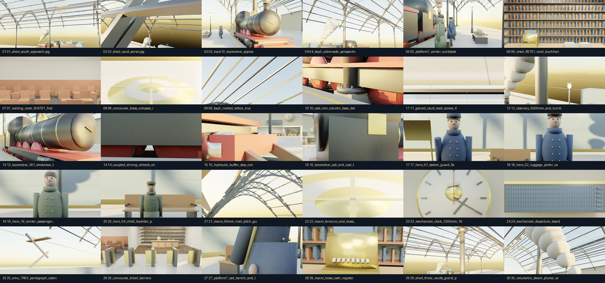

# NORDBAHNHOF — Best Renders Gallery (`nordbahnhof/renders/best/`)

- **Project:** `NORDBAHNHOF`
- **Builder:** `brunel` · **Task:** `t-20261019-62e7`
- **Gallery Count:** `30` JPEGs (`2560 × 1440` px) + `CONTACT_SHEET.jpg`
- **Total Size:** `16.17 MB` (limit `≤ 100 MB`; max single `995.8 KB` ≤ `4 MB`; `0` PNGs)`

## Thumbnail Index

| # | Image | Class | Camera | Size (KB) |
|---|---|---|---|---|
| 01 | [01_shed_south_approach.jpg](01_shed_south_approach.jpg) | `CAM_01_exterior_shed_south` | `625.9` |
| 02 | [02_shed_vault_aerial.jpg](02_shed_vault_aerial.jpg) | `CAM_02_exterior_vault_aerial` | `551.4` |
| 03 | [03_track10_locomotive_approach.jpg](03_track10_locomotive_approach.jpg) | `CAM_03_exterior_track_approach` | `612.8` |
| 04 | [04_bay5_colonnade_perspective.jpg](04_bay5_colonnade_perspective.jpg) | `CAM_04_exterior_colonade_bay5` | `601.9` |
| 05 | [05_platform7_winter_sunblade.jpg](05_platform7_winter_sunblade.jpg) | `CAM_05_interior_platform7_sunblade` | `578.7` |
| 06 | [06_retail_RET01_nord_buchhandlung.jpg](06_retail_RET01_nord_buchhandlung.jpg) | `CAM_06_interior_retail_RET01` | `995.8` |
| 07 | [07_waiting_room_WAIT01_first_class.jpg](07_waiting_room_WAIT01_first_class.jpg) | `CAM_07_interior_waiting_WAIT01` | `648.4` |
| 08 | [08_concourse_brass_compass_inlay.jpg](08_concourse_brass_compass_inlay.jpg) | `CAM_08_interior_concourse_compass` | `234.4` |
| 09 | [09_bay5_riveted_lattice_truss.jpg](09_bay5_riveted_lattice_truss.jpg) | `CAM_09_iron_bay5_truss_rivets` | `343.5` |
| 10 | [10_cast_iron_column_base_bolts.jpg](10_cast_iron_column_base_bolts.jpg) | `CAM_10_iron_column_capital_bolts` | `571.3` |
| 11 | [11_glazed_vault_lead_cames_4mm.jpg](11_glazed_vault_lead_cames_4mm.jpg) | `CAM_11_iron_glazing_cames_bay5` | `311.2` |
| 12 | [12_catenary_5500mm_and_turnbuckle.jpg](12_catenary_5500mm_and_turnbuckle.jpg) | `CAM_12_iron_catenary_turnbuckle` | `390.9` |
| 13 | [13_locomotive_V01_smokebox_threequarter.jpg](13_locomotive_V01_smokebox_threequarter.jpg) | `CAM_13_vehicle_loco_V01_threequarter` | `609.5` |
| 14 | [14_coupled_driving_wheels_on_rail.jpg](14_coupled_driving_wheels_on_rail.jpg) | `CAM_14_vehicle_wheels_on_rail_1435mm` | `515.6` |
| 15 | [15_hydraulic_buffer_stop_contact.jpg](15_hydraulic_buffer_stop_contact.jpg) | `CAM_15_vehicle_buffers_and_coupling` | `577.1` |
| 16 | [16_locomotive_cab_and_coal_tender.jpg](16_locomotive_cab_and_coal_tender.jpg) | `CAM_16_vehicle_tender_and_cab` | `499.3` |
| 17 | [17_hero_01_station_guard_flag.jpg](17_hero_01_station_guard_flag.jpg) | `CAM_17_human_guard_HERO01` | `536.9` |
| 18 | [18_hero_02_luggage_porter_cap.jpg](18_hero_02_luggage_porter_cap.jpg) | `CAM_18_human_porter_HERO02` | `535.2` |
| 19 | [19_hero_19_winter_passenger_valise.jpg](19_hero_19_winter_passenger_valise.jpg) | `CAM_19_human_passenger_HERO19` | `483.9` |
| 20 | [20_hero_04_child_traveller_platform.jpg](20_hero_04_child_traveller_platform.jpg) | `CAM_20_human_child_HERO04` | `553.6` |
| 21 | [21_macro_60mm_rivet_pitch_gusset.jpg](21_macro_60mm_rivet_pitch_gusset.jpg) | `CAM_21_macro_rivet_60mm_pitch` | `499.8` |
| 22 | [22_macro_terrazzo_and_brass_ring.jpg](22_macro_terrazzo_and_brass_ring.jpg) | `CAM_22_macro_terrazzo_brass_inlay` | `236.6` |
| 23 | [23_mechanism_clock_3200mm_1640.jpg](23_mechanism_clock_3200mm_1640.jpg) | `CAM_23_mech_clock_escapement_1640` | `411.0` |
| 24 | [24_mechanism_departure_board_240tiles.jpg](24_mechanism_departure_board_240tiles.jpg) | `CAM_24_mech_departure_board_240tiles` | `590.5` |
| 25 | [25_emu_TR03_pantograph_catenary.jpg](25_emu_TR03_pantograph_catenary.jpg) | `CAM_25_best_emu_pantograph_catenary` | `284.1` |
| 26 | [26_concourse_ticket_barriers_12gates.jpg](26_concourse_ticket_barriers_12gates.jpg) | `CAM_26_best_ticket_barriers_row` | `707.8` |
| 27 | [27_platform7_oak_bench_and_lamps.jpg](27_platform7_oak_bench_and_lamps.jpg) | `CAM_27_best_platform_bench_and_lamps` | `613.8` |
| 28 | [28_macro_brass_cash_register_RET01.jpg](28_macro_brass_cash_register_RET01.jpg) | `CAM_28_best_retail_cash_till_macro` | `692.4` |
| 29 | [29_shed_three_vaults_grand_panorama.jpg](29_shed_three_vaults_grand_panorama.jpg) | `CAM_29_best_shed_three_vaults_panorama` | `697.3` |
| 30 | [30_volumetric_steam_plume_vault.jpg](30_volumetric_steam_plume_vault.jpg) | `CAM_30_best_steam_plume_under_glazing` | `690.5` |

Producer-selected views. Independent non-owner acceptance remains PENDING.
No self-review/vote.
